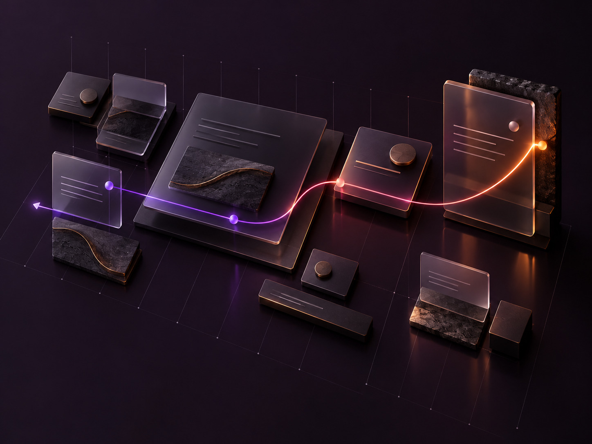

# Luma Taste

<p align="center">
  <strong>A Codex skill for designing and animating LUMA interfaces with a Persian-first visual system.</strong>
</p>

<p align="center">
  
</p>

<p align="center"><em>Purposeful motion. Clear RTL composition. Fast mobile pages.</em></p>

Luma Taste guides page work toward LUMA's dark, premium visual identity, expressive motion, clear RTL layouts, and fast mobile behavior. It applies to new pages as well as focused restyling of existing pages and components.

## Visual direction

<table>
  <tr>
    <th align="center">Expressive motion</th>
    <th align="center">Persian-first grid</th>
  </tr>
  <tr>
    <td></td>
    <td></td>
  </tr>
  <tr>
    <td align="center">A continuous motion study in LUMA's signature gradient.</td>
    <td align="center">A disciplined modular layout with right-to-left flow.</td>
  </tr>
</table>

## What it covers

- LUMA color, typography, shape, material, and Persian RTL rules
- A shared 12-column layout grid and component guidance that prevents clipped copy
- Motion patterns for entrances, hover interactions, scroll moments, marquees, and transient surfaces
- Performance budgets, reduced-motion behavior, and browser evidence requirements
- A Playwright-based audit script for layout and motion issues

The skill is intentionally LUMA-specific. Its visual choices are project standards, not a generic theme to apply to unrelated products. Starter CSS and JavaScript are references to adapt to the host application's conventions; they are not meant to be pasted in without review.

## Install

Install in a project when you want the bundled audit script to resolve that project's browser dependencies. From the application root:

```bash
git clone https://github.com/mathofdynamic/luma-taste.git .agents/skills/luma-taste
```

For discovery across projects, install it in your user skill directory instead.

### PowerShell

```powershell
$skillPath = if ($env:CODEX_HOME) {
  Join-Path $env:CODEX_HOME 'skills\luma-taste'
} else {
  Join-Path $HOME '.codex\skills\luma-taste'
}
git clone https://github.com/mathofdynamic/luma-taste.git $skillPath
```

### Bash

```bash
git clone https://github.com/mathofdynamic/luma-taste.git "${CODEX_HOME:-$HOME/.codex}/skills/luma-taste"
```

Restart Codex after installing if the skill does not appear in the current session. The audit script resolves `playwright-core` from its own location, so use the project installation above when running the audit with dependencies installed in the application.

## Use

Codex can select the skill automatically for LUMA design work. You can also invoke it directly:

```text
Use $luma-taste to redesign the LUMA services page for mobile and desktop.
```

The skill audits the existing page first, then plans, implements, and checks the requested surface. Its workflow requires a motion matrix and rendered-page evidence before claiming the result is verified.

## Run the motion audit

The audit runs against a locally served production build. Install `playwright-core` in the application project and make Chromium available to Playwright:

```bash
npm install --save-dev playwright-core
```

From the application root, run:

```bash
node .agents/skills/luma-taste/scripts/motion-audit.mjs \
  --url http://localhost:3000 \
  --out audit/motion \
  --widths 375,1440 \
  --themes dark,light \
  --seam
```

Use `--chrome <path>` when Playwright cannot find a Chromium executable, and `--theme-attr <attribute>` when the application uses a different theme attribute. The script reports structural and browser-observable issues; it does not judge visual taste or measure real-device frame rate. See [performance and verification](references/performance-and-verification.md) for the complete evidence protocol and limits.

## Repository layout

| Path | Purpose |
| --- | --- |
| [`SKILL.md`](SKILL.md) | Invocation, workflow, design standards, and reference map |
| [`references/`](references/) | Identity, layout, motion, entrance, process, and verification guidance |
| [`assets/`](assets/) | Starter design files and README artwork |
| [`assets/readme/`](assets/readme/) | Original 3D visuals for this README |
| [`scripts/motion-audit.mjs`](scripts/motion-audit.mjs) | Browser audit for motion and layout regressions |
| [`agents/openai.yaml`](agents/openai.yaml) | Codex display name and suggested prompt |

## License

No license is included. Public visibility does not grant permission to reuse, modify, or redistribute this material.
